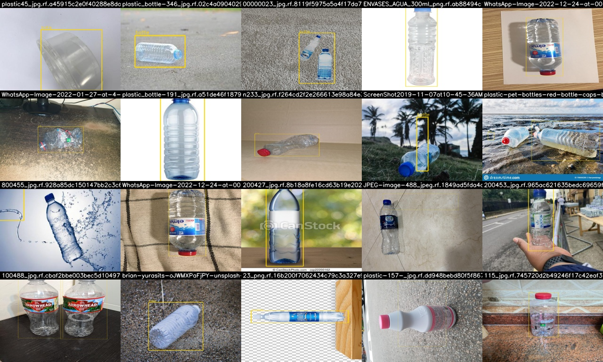

# Dataset review: bottles_yolo

## Boxes per class

| name | train | val | test | total |
|---|---|---|---|---|
| bottle | 3186 | 1550 | 792 | 5528 |

## Split statistics

| split | images | boxes | boxes per image | median box area % | boxes < 1% of image |
|---|---|---|---|---|---|
| train | 2177 | 3186 | 1.46 | 16.43 | 280 |
| val | 1174 | 1550 | 1.32 | 15.35 | 123 |
| test | 648 | 792 | 1.22 | 14.18 | 64 |

## Quality checks

| check | count | first examples |
|---|---|---|
| images_without_label | 0 |  |
| labels_without_image | 0 |  |
| empty_labels | 0 |  |
| out_of_range_boxes | 25 | test/bottle-208-_JPG.rf.735985d60ddb924c219f923adfbd0f82, test/bottle-280-_JPG.rf.95e4c5fa004537f4d8b49c101c4b1847, test/bottle-334-_JPG.rf.e2925e5dd3dce14a85da6cf35bd53033 |
| unknown_class_ids | 0 |  |
| tiny_boxes_lt_0.1pct | 116 | test/25_jpg.rf.442c800d667cfa1019930f957b9a04fb, test/56_jpg.rf.edae0a1dfb5a74e2dc93d2df570f7206, test/bottle-208-_JPG.rf.735985d60ddb924c219f923adfbd0f82 |
| duplicates_across_splits | 16 | train/empty-plastic-bottle-lying-around-park-ground-empty-plastic-bottle-lying-around-park-ground-146271701_jpg.rf.00152ad7ce88048bcf9815e69567a6fc = val/waterbottle211_jpg.rf.13876b72c714846be4a1245104cc44de, train/empty-plastic-water-bottle-500x500_jpg.rf.c7a67b6cf1ef5dde76ddb785eec5704f = val/waterbottle229_jpg.rf.5f68bf62aff29f3f95397ca28c3eefce, train/plastic234_jpg.rf.46cd4c97733e370339404d2203d409f1 = val/plasticbottle-440-_jpg.rf.0a446e93d9c565a1ae0fe6cfeb85b3da |

## 20-image grid (train, seed 0)

